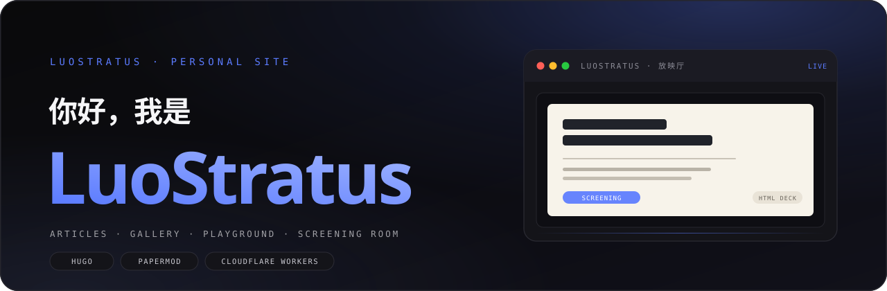

<div align="center">
  
  <br><br>
  <a href="https://luostratus.cn/"></a>
  
  
  
  

  <h2>用 Hugo + PaperMod 构建、部署在 Cloudflare Workers 上的中文个人网站。</h2>
  <p><sub>文章 · 画廊 · 小功能 · 放映厅 · 搜索 · 标签 · 归档 · 关于</sub></p>
</div>

> [!NOTE]
> 纯静态站点：没有后端、数据库或 API。文章、照片、61 个小工具、4 部 HTML 放映作品与搜索索引全部在仓库内，交互在浏览器端完成。

<div align="center">

| 文章 | 画廊图片 | 小工具 | 放映作品 |
| :---: | :---: | :---: | :---: |
| **7** | **35** | **61** | **4** |

</div>

## 目录

| 章节 | 你会看到 |
| --- | --- |
| [项目定位](#项目定位) | 站点是什么、不是什么、整体形态 |
| [功能地图](#功能地图) | 首页 / 文章 / 画廊 / 小功能 / 放映厅 / 搜索 / 标签归档 / 关于 / 404 |
| [视觉与交互](#视觉与交互) | F 主题、设计 token、外观设置、侧栏折叠、文章目录、响应式 |
| [技术栈](#技术栈) | Hugo、PaperMod、Cloudflare、原生 CSS/JS、技术要点与数据规模 |
| [目录结构](#目录结构) | 完整仓库树与各目录职责 |
| [本地开发](#本地开发) | 环境要求、构建命令、预览与验收 |
| [部署流程](#部署流程) | push 即部署、wrangler 配置、上线核对 |
| [版本规则](#版本规则) | `data/version.yaml`、patch / major 权限、页脚版本号 |
| [内容维护](#内容维护) | 新增文章、图片、工具、虚拟生成器、放映作品、法律数据 |
| [开发约定](#开发约定与已知陷阱) | partial 路径、Hugo 版本、CSS 变量、12 条实战陷阱 |
| [性能与可访问性](#性能与可访问性) | 静态化、图片处理、键盘可达、动效降级 |
| [已知限制](#已知限制) | 无后端、搜索索引、静态法律数据、浏览器目标 |
| [许可与致谢](#许可与致谢) | PaperMod、Pacifico、Hugo、Cloudflare |
| [联系方式](#联系方式) | GitHub、Bilibili、邮箱、站点 |

---

<a id="项目定位"></a>

## 项目定位

<sub>OVERVIEW · 这个站点是什么</sub>

这是一个“个人数字花园”式的静态站点，目标不是做博客框架，而是把长期写作、摄影、交互小工具和 HTML 放映作品放在同一个视觉体系里：

- **纯静态**：Hugo 生成 HTML/CSS/JS，Cloudflare Workers 只负责静态资源托管。
- **零后端**：没有登录、数据库、评论、服务端渲染或 API 服务；所有交互在浏览器中运行。
- **内容即仓库**：文章、图片、工具、放映稿、法律数据、字体全部可版本化追踪。
- **全站统一设计**：F（Product Launch）深色视觉体系，配合浅色主题与外观自定义。
- **工具优先自包含**：小功能页面不依赖外部框架或 CDN，单个 partial 即可独立运行。

站点主栏目：**文章 / 画廊 / 小功能 / 放映厅 / 搜索 / 标签 / 归档 / 关于**。

---

## 功能地图

<sub>FEATURES · 每个栏目实际能做什么</sub>

### 首页

- 自定义 Hero：`LUOSTRATUS · PERSONAL SITE` 眉题、`你好，我是` 标题、手写体 `LuoStratus` 名字、站点简介与两个主按钮（开始浏览 / 看看小功能）。
- 右侧“应用窗口”卡片：标题栏 + 红黄绿圆点 + 最新放映稿封面（16:9 内框），悬停轻微上浮，无旋转。
- 首页只渲染**最近两篇文章**（`layouts/index.html` 的 `where` + `first 2`），不是完整文章流。
- 社交入口：GitHub、Bilibili（`hugo.yaml` 的 `params.socialIcons`）。

### 文章

- 现有 7 篇文章，位于 `content/posts/`；列表页描述在 `content/posts/_index.md`。
- 详情页 `layouts/single.html`：`READING ROOM · 文章` 页头、大标题、日期/标签等元信息、目录、正文、前后篇导航。
- 支持 PaperMod 的标签、分类、面包屑、代码复制、文章目录（TOC）、RSS。
- 阅读时长关闭（`ShowReadingTime: false`）；分享按钮关闭；每页 10 篇分页。
- 正文表格在窄屏横向滚动，单元格最小宽度 72px、允许换行，避免 4 列表格被裁切。
- 代码高亮 `catppuccin-macchiato`，保留 class（`noClasses: false`），便于主题覆盖。
- 文章页额外有滚动时出现的浮动目录（桌面端）、当前小节高亮、目录折叠按钮。

### 画廊

- Branch Bundle：`content/gallery/_index.md` + 同目录图片资源，现有 **35 张**。
- 固定首图 `00-校色卡.png` 永远第一，使用 eager 加载和 high 优先级；其余按日期排序。
- 文件名日期解析支持两种格式：
  - `YYYY-MM-DD` 前缀，例如 `2026-07-01_15.23.21.webp`；
  - 文件名中任意位置的 `20xxxxxx`，例如 `mmexport1682250305721_20230511_194506_072.jpg`。
- 有日期的图片按日期倒序；无日期图片随机打乱，并按间隔穿插进有日期图片之间。
- 缩略图：宽度超过 800px 的图片用 Hugo `Resize` 生成 `800x webp q78`；原图地址保存在 `data-full`。
- 瀑布流为 CSS `column-count: 2`；点击图片在缩略图/原图之间切换放大，不弹独立灯箱。
- 图片 `loading="lazy"`、`decoding="async"`，首图除外。

### 小功能（Playground）

入口在 `content/tools/`，页面实现统一放在 `layouts/partials/tools/`，列表页在 `layouts/tools/list.html`。

列表页统计：**23 个实用工具 + 25 个游戏 + 13 个虚拟生成器 = 61 个工具**（`_index.md` 不计入）。

#### 实用工具（23）

| 工具 | 工具 | 工具 |
| --- | --- | --- |
| 法律查阅 | 配色工坊 | 单位换算 |
| 进制与数字转换 | BMI 计算器 | 摩斯电码 |
| 随机数生成 | 密码生成器 | 番茄钟 |
| 秒表与倒计时 | 日期计算器 | 文本统计 |
| 文本格式转换 | Base64 编解码 | URL 编解码 |
| JSON 格式化 | 颜色转换器 | 科学计算器 |
| 正则表达式测试器 | 转盘抽奖 | Markdown 实时预览 |
| 节拍器 | 白噪音 |  |

重点工具：

- **法律查阅**：`layouts/tools/law-search.html` 加载 `static/laws/app.css` 与 `static/laws/app.js`；`static/laws/index.json` 为检索索引；`static/laws/` 下共 520 个文件（`data/` 与 `search/` 中的 517 个 JSON 分片 + `index.json` + 前端资源）。支持宪法与法律查阅、全文检索、多版本切换、生效时间轴。
- **配色工坊**：`layouts/partials/tools/color-palette.html`，单文件原生 JS。支持从一个颜色或一张图片生成 3 套配色、实时预览、WCAG 对比度检测与一键修复、色弱模拟、收藏/历史（localStorage）、导出 CSS/JSON/SVG/PNG、URL 参数分享。
- **摩斯电码**：文字与电码双向转换，支持播放摩斯音、调节 WPM。
- **番茄钟 / 秒表 / 节拍器 / 白噪音**：使用 Web Audio 或计时器 API，无外部音频文件依赖（白噪音为程序化生成）。

#### 游戏（25）

| 游戏 | 游戏 | 游戏 |
| --- | --- | --- |
| 贪吃蛇 | 俄罗斯方块 | 打砖块 |
| 2048 | 扫雷 | 记忆翻牌 |
| 点击速度测试 | 颜色识别测试 | 数独 |
| 24 点 | 五子棋 | 井字棋 |
| 华容道 | 15 数字拼图 | 推箱子 |
| 连连看 | 三消消除 | 打地鼠 |
| 西蒙说 | 猜数字 | 数织 |
| 反应训练 | 打字速度测试 | 坦克大战 |
| 太空射击 |  |  |

游戏均为独立 partial（如 `snake.html`、`tetris.html`），使用原生 Canvas / DOM / CSS 实现，不依赖游戏引擎。部分游戏包含 AI（五子棋、井字棋）、关卡（华容道、推箱子、数织）、计时与连击（打砖块、24 点）等完整规则。

#### 虚拟生成器（13）

这些生成器不是 Hugo partial，而是放在 `static/virtual/<slug>/index.html` 的独立页面；`content/tools/<slug>.md` 使用 `layout: redirect` + `target` 做跳转。

| 生成器 | 用途 |
| --- | --- |
| 时间线 | 人物生平、架空历史与世界观编年史长图 |
| 歌词与播放列表 | 歌词节点、歌曲信息与角色播放列表 |
| 社交帖子生成器 | 虚构帖子、账户页面、回复链与社交档案 |
| 邮件档案 | 虚构邮箱、邮件正文与多轮回复线程 |
| 大众点评 | 餐馆、菜品、商品与服务的虚构点评详情页 |
| 购物车与结算 | 虚构购物车、账户资料与订单结算页面 |
| 小票与 Invoice | 机打小票、账单与可自由摆放贴纸的 Invoice |
| 模拟电脑桌面 | 带角色档案、窗口、便签与自由素材的桌面情绪板 |
| 背包 | 角色资料、随身装备与私人物件组成的背包界面 |
| 鉴定书生成器 | 珠宝、文物、司法、伤情与通用鉴定文书 |
| 小册 | 封面、目录、文章、藏品页与折页拼版组成的收藏小册 |
| 快递面单工坊 | 国内、国际、双语、赛博、复古与潮牌六种风格面单 |
| 设定卡工坊 | 档案、杂志、RPG 与手帐四种风格的角色设定卡 |

共享资源在 `static/virtual/shared/`：`site-theme.css` / `site-theme.js`（统一主题）、`browser-image-store.js`（本地图片存储）、`export-fonts.js`（导出字体处理）、`oc-color-picker.css` / `oc-color-picker.js`（取色器）。

### 放映厅

- 现有 **4 部 HTML 放映作品**：团员支书竞选、朱雀三号、长征十号乙、劳动权益重要法律知识整理。
- 内容结构：`content/cinema/<slug>/index.md` + `cover.png`，放映页面本体在 `static/decks/<slug>/index.html`。
- 列表页：`SCREENING ROOM · 放映厅` 页头、作品数统计、按日期倒序的卡片；第一张为横向大卡并带 `LATEST · 最新放映` 徽章。
- 详情页：封面、`开始放映` 主按钮（新窗口打开 deck）、简介、正文；`target` 指向实际 deck，`slides` 显示页数。
- 放映器能力（以劳动权益 deck 为例）：方向键/空格翻页、滚轮翻页、触屏滑动、`ESC` 打开 15 页索引、`F` 全屏、hash 页码同步、图片预加载；同时提供原版 PPTX 下载。
- 封面与 deck 均为静态资源，不依赖第三方幻灯片服务。

### 搜索

- 搜索页 `layouts/search.html`，使用 PaperMod 的客户端搜索（Fuse.js）。
- 索引由 `layouts/index.json` 生成：合并 `site.RegularPages` 与小功能页面，排除 `searchHidden`、`archives` 布局与 `search` 布局；索引包含标题、正文、描述与摘要。
- 搜索框支持实时结果、标题与正文匹配、最长 64 字符；搜索页有 F 风格 hero 与提示文案。
- 完全在浏览器内完成，不发送请求到后端。

### 标签与归档

- 分类法：`tag: tags`、`category: categories`（`hugo.yaml`）。
- 标签页为胶囊网格，点击进入对应标签文章列表。
- 归档页 `layouts/archives.html` 只展示 `posts`，按 `2006年1月` 格式的中文月份分组，附文章数统计与卡片式条目。
- 归档页使用独立布局，不进入搜索索引。

### 关于与 404

- `content/about.md`：个人介绍、分享内容、GitHub / Bilibili / 邮箱。
- `layouts/404.html`：F 风格渐变 `404` 大字、说明文案与“回到首页”按钮。

### 全站通用能力

- 顶部导航：文章 / 画廊 / 小功能 / 放映厅 / 搜索 / 标签 / 归档 / 关于。
- 明暗主题切换：头部太阳/月亮按钮；默认深色，支持浅色与自动跟随系统。
- 外观设置面板：文字颜色、背景颜色、卡片颜色三个页签，各 6 个预设 + 自定义取色；可一键恢复默认。
- 侧边快捷导航：顶部导航滚出视口后出现在右侧，包含全部 8 个栏目；可折叠成单个箭头按钮，折叠状态持久化。
- 回到顶部：滚动超过一屏后出现，支持 `Alt + G`。
- 代码块复制、图片加载淡入、滚动渐入、卡片悬浮、链接下划线动画、平滑滚动。
- 页脚显示 `Last Updated`（UTC+8）与 `Version V{year}.{major}.{patch}`。

---

## 视觉与交互

<sub>DESIGN · F 主题与全站交互</sub>

### F 主题（Product Launch 风格）

视觉是深色现代风，样式集中在 `layouts/partials/extend_head.html` 的 `<style id="f-theme">`。

| Token | 深色 | 浅色 |
| --- | --- | --- |
| `--theme` | `#0A0A0B` | `#FFFFFF` |
| `--entry` | `#141419` | `#F6F6F9` |
| `--border` | `#26262D` | `#E4E4EA` |
| `--primary` | `#F5F5F7` | `#0A0A0B` |
| `--secondary` | `#A1A1A6` | `#5D5D66` |
| `--f-accent` | `#5B7BFF` | 同左 |

- 色板、卡片、按钮、边框、代码块全部由 CSS 变量驱动；外观设置通过内联变量覆盖 token，因此改色不会破坏主题结构。
- 首页 hero、各栏目 page hero、卡片、统计数字、窗口卡片、404 都有统一的 F 设计层（kicker、标题、统计行、圆角卡片、渐变/毛玻璃）。
- 字体：正文使用 `Segoe UI Variable / Segoe UI / Microsoft YaHei UI / PingFang SC` 系统字体栈；`LuoStratus` 名字使用自托管 Pacifico 手写体（`static/fonts/Pacifico-Regular.ttf`，约 329KB，OFL）。
- 动效：导航毛玻璃、卡片悬停上浮、窗口卡片悬停、入场淡入、主题切换过渡；放映详情主按钮的脉冲动画在 `prefers-reduced-motion: reduce` 下关闭。

### 外观设置

入口：页头调色盘按钮，面板由 `extend_footer.html` 动态插入。

| 能力 | 细节 |
| --- | --- |
| 文字颜色 | 6 个预设 + 自定义；推导 `--primary`、`--secondary`、`--content` |
| 背景颜色 | 6 个预设 + 自定义；推导 `--theme`、`--entry`、`--code-bg`、`--border`、`--tertiary` 与 `color-scheme` |
| 卡片颜色 | 6 个预设 + 自定义；与背景色一起计算表面调色板 |
| 模式 | 自动 / 浅色 / 深色；自动写入 `pref-theme=auto` 并跟随系统 |
| 持久化 | `pref-appearance-v2`（颜色）、`pref-theme`（主题）；兼容旧键 `pref-text-color`、`pref-menu-text` |
| 重置 | 清除上述键并恢复默认外观 |
| 交互 | 点击外部关闭、`ESC` 关闭、`aria-expanded` 同步 |

### 侧边快捷导航

- 顶部导航滚出视口后显示在右侧（`#side-nav`），由 `buildSideNav()` 从顶部菜单复制链接。
- 顶部折叠按钮（`#side-nav-toggle`）在展开/收起之间切换。
- 收起时链接高度 36px → 0、透明度 1 → 0、向右移动 12px，约 280ms；`gap` 同步过渡；箭头旋转 180°。
- 状态写入 `localStorage` 的 `side-nav-collapsed`，刷新或换页保持；收起时链接加 `tabindex="-1"`，不可键盘聚焦。

### 文章目录

- 文章页存在 `.post-content` 且标题 ≥2 个时构建浮动目录（h2/h3）。
- 使用 `IntersectionObserver` 高亮当前小节；支持折叠/展开；`/about` 页不显示。
- 桌面端固定展示，移动端自适应。

### 响应式

| 视口 | 行为 |
| --- | --- |
| 桌面 | 内容最大宽度约 1000px（首页/列表），工具页 680–820px，放映详情 920px，放映列表 1120px |
| 平板 | 导航进入折叠菜单，侧栏收窄 |
| 手机 | Hero 单列、窗口卡片全宽、放映横卡改单列、画廊 ≤480px 单列、侧栏按钮 32px |
| 工具页 | 表单与画布按容器宽度自适应，500px 视口可用 |

---

## 技术栈

<sub>STACK · 依赖越少越好</sub>

| 层 | 选型 | 说明 |
| --- | --- | --- |
| 静态生成 | Hugo Extended v0.164（本地） | 本地构建与预览 |
| 构建环境 | Hugo v0.147.7（Cloudflare） | Cloudflare 构建环境更旧，模板需兼容 |
| 主题 | PaperMod（Git submodule） | `themes/PaperMod`，通过 `extend_head.html` / `extend_footer.html` 注入定制 |
| 样式 | 原生 CSS + CSS 变量 | 无 Sass/Less/PostCSS 构建链 |
| 脚本 | 原生 JavaScript（ES6+） | 无 React/Vue/jQuery；搜索使用 PaperMod 内置 Fuse.js |
| 托管 | Cloudflare Workers 静态资源 | `wrangler.jsonc` 的 `assets.directory = public` |
| 版本控制 | Git / GitHub | push `master` 自动部署 |
| 字体 | Pacifico（自托管，OFL） | 仅用于首页名字 |

没有 `package.json` 构建依赖；站点构建只依赖 Hugo。Node.js 仅在需要手动执行 `wrangler` 时使用。

> [!IMPORTANT]
> Cloudflare 构建环境的 Hugo 是 **v0.147.7**，本地是 v0.164。模板中避免使用 `cond`，改用 `if/else` 或 `first`；否则线上可能构建失败。

### 技术要点

- **无运行时**：没有服务端、数据库或 API；Cloudflare Worker 只做静态资源托管，没有 Worker 业务脚本。
- **不 fork 主题**：PaperMod 保持 submodule 原样，所有定制通过 `extend_head.html`（CSS）与 `extend_footer.html`（JS）注入，升级主题成本低。
- **设计 token 化**：颜色、圆角、尺寸都收敛到 CSS 变量；外观设置通过内联变量覆盖 token，而不是替换整套样式。
- **工具隔离**：每个小工具是独立的 `layouts/partials/tools/<slug>.html`，自带样式与脚本，互不继承、互不污染；列表页只负责入口与分组。
- **虚拟生成器独立**：13 个生成器是 `static/virtual/` 下的独立 HTML 页面，通过 redirect 入口接入站点，共享 `static/virtual/shared/` 的主题、导出与图片存储逻辑。
- **搜索静态化**：Hugo 构建时生成 `/index.json`，浏览器端用 Fuse.js 检索，不依赖外部搜索服务。
- **放映器自包含**：每部 deck 是一个独立的 `static/decks/<slug>/index.html`，键盘/滚轮/触屏/索引/全屏/hash 同步全部在单文件内实现。
- **图片由 Hugo 处理**：画廊缩略图在构建期通过 `Resize` 生成 webp，无需外部图片 CDN。
- **版本单一来源**：`data/version.yaml` 驱动页脚版本号，避免多处硬编码。

### 数据规模

| 内容 | 数量 |
| --- | --- |
| 文章 | 7 篇 |
| 画廊图片 | 35 张 |
| 小功能 | 61 个（25 游戏 + 23 实用工具 + 13 虚拟生成器） |
| 放映作品 | 4 部 |
| 法律数据 | 520 个文件（517 个 JSON 分片 + 前端） |
| 自托管字体 | 2 个文件（Pacifico + OFL） |
| 页面构建 | 134 pages（0 ERROR 基准） |

---

## 目录结构

<sub>STRUCTURE · 仓库里有什么</sub>

```text
luostratus.cn/
├── hugo.yaml                  # 站点配置：baseURL、菜单、分页、语法高亮、输出、社交图标
├── wrangler.jsonc             # Cloudflare Workers 静态资源配置（assets: public）
├── README.md                  # 仓库首页文档
├── docs/
│   └── readme-banner.svg      # README 顶部横幅
├── data/
│   └── version.yaml           # 站点版本号唯一来源（year / major / patch）
├── content/
│   ├── posts/                 # 文章（7 篇 + _index.md）
│   ├── gallery/               # 画廊 Branch Bundle（_index.md + 35 张图片）
│   ├── tools/                 # 小功能入口（61 个工具 + _index.md）
│   ├── cinema/                # 放映厅（4 个 Bundle：index.md + cover.png）
│   ├── about.md               # 关于页
│   ├── archives.md            # 归档页（layout: archives）
│   └── search.md              # 搜索页（layout: search）
├── layouts/
│   ├── index.html             # 首页：hero + 最近 2 篇文章
│   ├── index.json             # 搜索索引（文章 + 小功能）
│   ├── single.html            # F 风格文章/关于页
│   ├── search.html            # F 风格搜索页
│   ├── archives.html          # 归档页（只含 posts，中文月份分组）
│   ├── 404.html               # 自定义 404
│   ├── _partials/
│   │   ├── home_info.html     # 首页 hero + 窗口卡片
│   │   └── post_meta.html     # 文章元信息
│   ├── partials/
│   │   ├── extend_head.html   # 全站 CSS（含 F 主题、外观面板、响应式、动效）
│   │   ├── extend_footer.html # 全站 JS（目录、侧栏、外观、主题等）
│   │   ├── footer.html        # 页脚（Last Updated + Version + 返回顶部）
│   │   └── tools/             # 61 个工具实现（每个工具一个独立 HTML/CSS/JS）
│   ├── gallery/
│   │   ├── list.html          # 瀑布流、日期解析、缩略图、点击放大
│   │   └── single.html
│   ├── cinema/
│   │   ├── list.html          # 放映厅列表（最新横卡）
│   │   └── single.html        # 放映详情（开始放映按钮）
│   └── tools/
│       ├── list.html          # 小功能主页（games / utils / virtual 三组数组）
│       ├── single.html        # 按文件名加载 partial
│       ├── law-search.html    # 法律查阅专用页面
│       └── redirect.html      # 虚拟生成器跳转页
├── static/
│   ├── decks/                 # 4 部放映作品（自包含 HTML + 封面/PPTX）
│   ├── virtual/               # 13 个虚拟生成器 + shared 共享资源
│   ├── laws/                  # 法律查阅前端 + 517 个 JSON 数据分片
│   ├── fonts/                 # Pacifico-Regular.ttf + OFL 许可证
│   └── favicon* / apple-touch-icon.png
├── scripts/laws/              # 法律数据提取与校验脚本（离线处理）
├── themes/PaperMod/           # Git submodule
└── .gitignore                 # 忽略 public/、resources/、backup/ 等
```

---

## 本地开发

<sub>DEVELOPMENT · 从 clone 到 0 ERROR</sub>

### 环境要求

- **Hugo Extended**：本地建议 v0.164（构建环境 v0.147.7，模板必须兼容）。
- Git（用于拉取 PaperMod submodule）。
- 可选：Node.js + Wrangler（仅手动部署时需要）。

### 克隆与构建

```bash
git clone --recurse-submodules https://github.com/Axon-Luo/luostratus.cn.git
cd luostratus.cn

# 构建（推送到线上前的必做步骤）
hugo --gc --minify

# 本地预览（含草稿）
hugo server -D
```

Windows 本地 Hugo 可执行文件示例：

```powershell
& "C:\Users\LuoYun\AppData\Local\Microsoft\WinGet\Packages\Hugo.Hugo.Extended_Microsoft.Winget.Source_8wekyb3d8bbwe\hugo.exe" --gc --minify
```

> [!TIP]
> 构建成功标准：`Pages` 数量正常、**0 ERROR**。`public/` 是生成目录，不入库。

### 本地验证建议

- 桌面 1280px 与移动 500px 两档截图检查。
- 明暗主题、外观设置改色、侧栏折叠、搜索、文章目录逐项点测。
- 工具页必须实际交互（Canvas、计时器、localStorage、音频），不能只看静态截图。
- 修改背景/浮层后用浏览器计算样式确认层叠与可见性。

---

## 部署流程

<sub>DEPLOY · push 即发布</sub>

1. 本地构建确认 0 ERROR。
2. 提交并推送 `master`：

   ```bash
   git add -A
   git commit -m "描述改动"
   git push origin master
   ```

3. Cloudflare Workers Builds 监听到 `master` 更新后自动构建并发布 `public/`。
4. 等待构建完成（可能排队），核对线上页脚 `Version V{year}.{major}.{patch}` 与目标功能。
5. 如需手动部署，可使用 Wrangler：

   ```bash
   npx wrangler deploy
   ```

`wrangler.jsonc` 关键项：`name: luostratus-cn`、`assets.directory: public`、`compatibility_date: 2026-07-26`、`nodejs_compat`、`observability.enabled: true`。站点没有 Worker 脚本，只有静态资源。

> [!NOTE]
> Cloudflare 构建可能排队 10–30 分钟。不要因为页脚暂时没更新就更换发布通道，先确认构建队列。

---

## 版本规则

<sub>VERSIONING · 每一次提交都算一次更新</sub>

版本号唯一来源是 `data/version.yaml`：

```yaml
year: 26
major: 14
patch: 14
```

页脚显示 `Version V26.14.14`。

| 位 | 规则 |
| --- | --- |
| `patch`（CC） | 日常默认 +1：内容发布、样式调整、修复、清理、文档 |
| `major`（BB） | **只能由用户明确决定**，Agent 不得自行 +1，即使自评 S/A 级 |
| `year`（AA） | 跨年时改为新年后两位，major 与 patch 继续累积，不重置 |

- 版号变更与改动放在**同一个提交**里。
- merge 提交若自身无文件变更，不单独计数，随被合并的提交计算。
- 历史节点：`V26.14.0` 为 2026-10-24 F 整站改版（用户指定的重大更新）；`V26.14.11` 为回滚渐变网点背景后的版本。

> [!WARNING]
> 不要自行提升 major。这是用户明确下达的规则，优先级高于任何“本次改动看起来很大”的判断。

---

## 内容维护

<sub>MAINTENANCE · 怎么往里加东西</sub>

### 新增文章

在 `content/posts/` 新建 Markdown：

```yaml
---
date: '2026-11-08T10:00:00+08:00'
draft: false
title: 文章标题
tags:
  - 标签
description: 一句话摘要
---
```

`draft: true` 的文章不会进入生产构建。文章列表页描述在 `content/posts/_index.md`。

### 新增画廊图片

- 直接把图片放入 `content/gallery/`（Branch Bundle）。
- 文件名带 `YYYY-MM-DD` 或 `20xxxxxx` 才会参与日期排序；不带日期的图片会随机穿插。
- 首图固定为 `00-校色卡.png`。
- 超过 800px 宽的图片自动生成 webp 缩略图；原图保留用于点击放大。

### 新增小工具

1. 新建 `content/tools/<slug>.md`（`title` + `description`，可选 `layout`）。
2. 新建 `layouts/partials/tools/<slug>.html`（完整 HTML/CSS/JS；**必须**放在 `layouts/partials/tools/`）。
3. 在 `layouts/tools/list.html` 的 `$utils`、`$games` 或 `$virtual` 数组中添加一条 `dict`（slug / icon / name / desc，虚拟生成器用 href）。
4. 本地构建并实际交互测试，再提交。

工具页约定：内容单列居中、最宽 680px；标题头居中（h1 + 简介）；区块使用 `var(--entry)` 卡片 + `var(--border)` + 12px 圆角 + 20px 内边距；主按钮通栏；表单“标签在左、控件在右”；同时适配明暗主题。

### 新增虚拟生成器

- 页面本体放 `static/virtual/<slug>/index.html`。
- `content/tools/<slug>.md` 使用：

  ```yaml
  layout: redirect
  target: "/virtual/<slug>/"
  ```

- 共享样式/脚本放 `static/virtual/shared/`，不要重复复制。

### 新增放映作品

1. `content/cinema/<slug>/index.md`（`title`、`description`、`date`、`slides`、`target`）。
2. `content/cinema/<slug>/cover.png`。
3. `static/decks/<slug>/index.html`（自包含放映页；可选 PPTX 等附件）。
4. 列表按 `date` 倒序，第一张自动成为 LATEST 横卡。

### 法律数据

- 前端：`static/laws/app.css`、`app.js`、`index.json`。
- 数据：`static/laws/data/*.json` 与 `static/laws/search/*.json`（`static/laws/` 共 520 个文件，其中 517 个 JSON 数据/检索分片）。
- 提取/校验脚本在 `scripts/laws/`，属于离线处理，不参与线上构建。

---

## 开发约定与已知陷阱

<sub>CONVENTIONS · 踩过的坑，别再踩</sub>

| 陷阱 | 正确处理 |
| --- | --- |
| partial 路径 | `partial "tools/x.html"` 只查找 `layouts/partials/tools/x.html`，不会查找 `layouts/tools/x.html` |
| Hugo 版本 | Cloudflare 是 v0.147.7；避免 `cond`，改用 `if/else` 或 `first` |
| 推送前构建 | 必须本地构建确认 0 ERROR；不提交 `public/`、`resources/`、`backup/`、`debug.log`、`.laws-work/` |
| 交接文档 | `HANDOFF.md`、`CLAUDE.md` 是本地 Agent 文档，不提交、不推送、不影响网站 |
| `class="main"` | 局部按钮不要用，会与 PaperMod 的 `.main { margin: auto }` 冲突 |
| 选择器特异性 | `.main [class$="-wrap"] button/input/textarea` 会覆盖组件字号，组件按钮要用更高特异性或 ID |
| 改色 | 走 `--theme/--entry/--primary/--secondary/--content/--border` 变量，不要硬编码颜色 |
| 背景/浮层 | 负 z-index 伪元素可能被 body 背景遮挡；优先用 body 多层背景或显式层级方案 |
| `:root` 选择器 | 不要写 `:root ... html`，`html` 不可能作为 `:root` 的后代 |
| 推送历史 | 不执行 `git reset --hard`、强制推送或删除历史；正常回滚用 `git revert` |
| 构建排队 | Cloudflare 可能排队 10–30 分钟，不要急着换发布通道 |
| 中文校验 | 读取线上 HTML 必须按 UTF-8 解码，否则中文会被误判为未部署 |

---

## 性能与可访问性

<sub>QUALITY · 快、稳、能用键盘</sub>

- 纯静态 HTML/CSS/JS，无前端框架运行时。
- 图片按需生成缩略图（800px webp q78），列表图片 `loading="lazy"`，首图 eager。
- 字体仅首页手写名字使用，自托管 329KB；正文使用系统字体栈。
- 无第三方 CDN、无追踪脚本、无外部请求（除社交链接与 shields 徽章）。
- 交互控件带 `aria-label` / `aria-expanded` / `title`；外观面板可用 `ESC` 关闭，侧栏折叠按钮同步 `aria-label`。
- 放映详情主按钮动画尊重 `prefers-reduced-motion`。
- 键盘可达：搜索框、主题切换、外观面板、侧栏折叠、返回顶部（`Alt + G`）。
- 移动端优先：导航、侧栏、卡片、表格、画布均有断点适配。

---

## 已知限制

<sub>LIMITS · 当前不做什么</sub>

| 限制 | 说明 |
| --- | --- |
| 无后端 | 没有评论、登录、点赞、访问统计或服务端搜索 |
| 搜索索引 | 随文章/工具增长而变大；超大数据量时需要拆分索引 |
| 法律数据 | 静态快照，更新依赖 `scripts/laws/` 离线重新提取 |
| Hugo 版本 | Cloudflare 构建环境低于本地，模板必须保持向前兼容 |
| 画廊 | 2 列瀑布流，移动端不提供独立灯箱/手势缩放 |
| 浏览器 | 目标为现代 Chromium/Firefox/Safari；不支持 IE |
| 构建流程 | 没有独立构建脚本/CI 配置，构建与版本检查依赖人工流程 |

---

## 许可与致谢

<sub>CREDITS · 站在这些项目肩上</sub>

- 主题：[PaperMod](https://github.com/adityatelange/hugo-PaperMod)（MIT License，以 Git submodule 引入）。
- 字体：[Pacifico](https://fonts.google.com/specimen/Pacifico)（SIL Open Font License 1.1），许可证见 `static/fonts/Pacifico-OFL.txt`。
- 静态生成：[Hugo](https://gohugo.io/)。
- 托管：[Cloudflare Workers](https://workers.cloudflare.com/)。
- 站点文章、照片、放映作品、工具代码与品牌素材版权归 LuoStratus 所有；仓库未附带额外开源许可证，默认保留所有权利。第三方依赖遵循其各自许可证。

---

## 联系方式

<sub>CONTACT · 找到我</sub>

<div align="center">

[GitHub](https://github.com/Axon-Luo) · [Bilibili](https://space.bilibili.com/438193192) · [Email](mailto:LuoStratus@foxmail.com) · [luostratus.cn](https://luostratus.cn/)

<br>

<sub>Built with Hugo + PaperMod · Deployed on Cloudflare Workers</sub>

</div>
